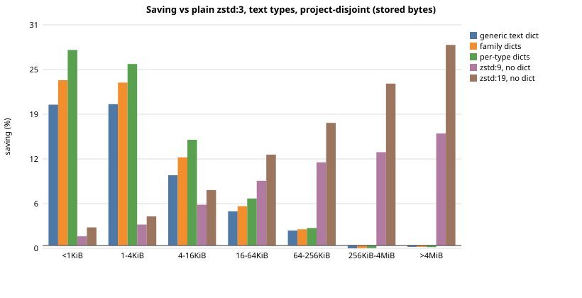
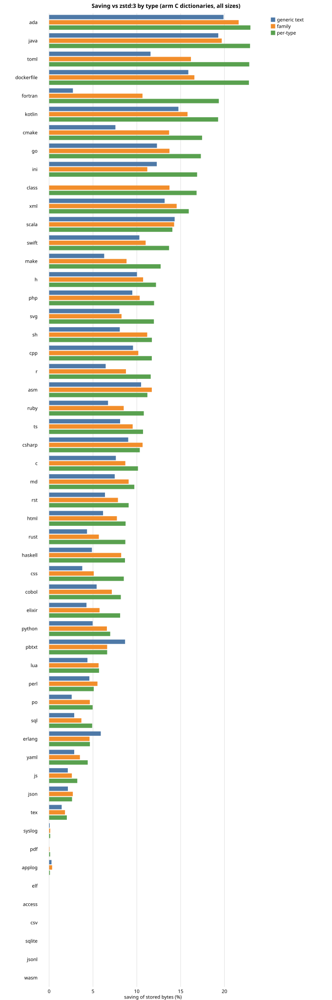
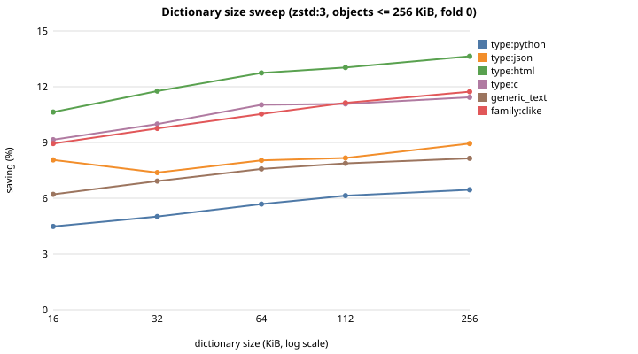
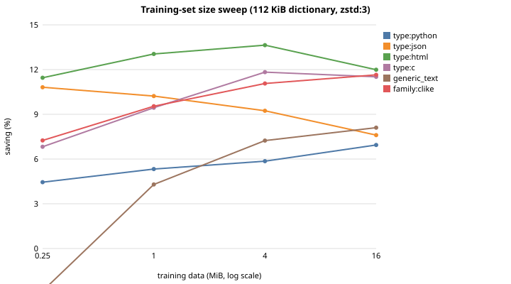
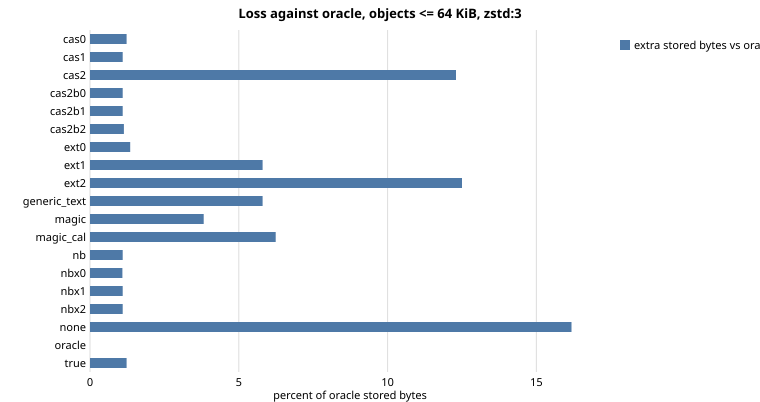

# Pre-trained zstd dictionaries for well-known file types in Constellation: measurement study

Date: 2026-11-12. Status: measurement report with a recommendation. Nothing here is shipped or committed. Licence statements are engineering assumptions that counsel must confirm; they are not legal conclusions.

## 1. Abstract

Constellation compresses every chunk object on its own with zstd (default zstd:3). A file smaller than the chunk size (4 MiB) is one object, so a small source file is compressed with no history. We measured whether dictionaries trained once on public data, and carried in the binary, shrink those objects, at which granularity they should be trained, and how well the right dictionary can be picked from the file name or from the content.

The corpus is 286,859 files (4.2 GiB, 58 file types, 431 sources: git repositories, jars, npm packages, distribution packages, generated logs). Dictionaries are 110 KiB. Training and test sets are disjoint by project (4 folds). A separate "new ecosystem" test set (56 projects never used for training) checks transfer. Results are stored bytes including the 16 B object header.

- **The gain is real and concentrated in small objects.** At zstd:3 on text types, project-disjoint, a per-type dictionary saves 27.8 % of stored bytes on objects under 1 KiB, 25.8 % on 1-4 KiB, 15.0 % on 4-16 KiB, 6.7 % on 16-64 KiB and 2.4 % on 64-256 KiB. From 256 KiB it is slightly negative (-0.4 %).
- **Granularity pays in steps.** On 1-64 KiB objects one generic text dictionary saves 9.7 %, eight family dictionaries 11.6 %, per-type dictionaries 13.5 %, per-extension splits 13.6 % (only Fortran gains from them). On projects of a new ecosystem the same figures are 6.7 %, 8.1 %, 8.9 %.
- **A dictionary beats raising the level below about 16 KiB.** At 4-16 KiB a type dictionary at zstd:3 saves 15.1 % against 5.8 % for zstd:9 and 7.9 % for zstd:19. At 16-64 KiB zstd:9 (9.2 %) and zstd:19 (13.0 %) win. Dictionaries stack with levels: at zstd:9 the dictionary still saves 20.0 % on 4-16 KiB objects.
- **Selection.** A content-only naive Bayes classifier (80.8 % exact-type accuracy, 2.9 M weights) loses 1.10 % of stored bytes against the oracle, as little as a perfect type selector (1.23 %). The extension map works on real names (1.35 %). Without an extension it is no better than one generic dictionary (5.8 %), and with a misleading extension it is worse than that (12.5 %). libmagic identifies 43 % of types and loses 3.8 %.
- **Recommendation: go**, with 33 dictionaries (3.5 MiB), selected by the content classifier and applied only to objects under 64 KiB by default. Copyleft training data adds under 1 pp for all but four types, so most dictionaries can be trained on permissive data only.

## 2. Question

1. Do pre-trained dictionaries for known file types improve compression of Constellation's chunk objects?
2. At what granularity: one text dictionary, families (C-like, scripting, markup, data), one per language or format, or per extension?
3. How well can the right dictionary be chosen from the file name (extension map) and from the content alone (a `file`-like matcher), and what does a wrong choice cost against the best possible?
4. What does a dictionary gain at the default level against simply raising the level? Does the gain survive project-disjoint testing and a new-ecosystem test?

The decision rules were written before any measurement (`PREREGISTERED.md`) and are applied in section 8. Where I made a judgement beyond them, section 8 says so.

## 3. Setup: Constellation's storage model, as verified in the source

Checked in `constellation/docs/explanation/DESIGN.md` §3, `DECISIONS.md` (ADR-10, ADR-11), `crates/fs-core` and `replicix-core/crates/chunkfmt`:

- **Chunking.** Files are split into fixed-size chunks, 4 MiB by default (`DEFAULT_CHUNK_SIZE`, `fs-core/src/lib.rs`), configurable 1-64 MiB per filesystem and recorded per file. Chunk count is `ceil(file_len / chunk_size)` and the last chunk is shorter (`fs-core/src/chunk.rs`). A file under the chunk size is therefore one object holding the whole file.
- **No packing yet.** The manifest entry types `slice-overlay`, `pack` and `cdc` are reserved and unimplemented (`fs-core/src/manifest.rs`, ADR-11). Small files are not combined, so each is compressed alone.
- **Per-object compression.** Each chunk object is compressed on its own (`chunkfmt/src/codec.rs`): zstd at the path's level, and if the output is not smaller than the input the object is stored raw (incompressible guard). The header is 16 B (`HEADER_LEN`: magic, format version, codec id u16, level, uncompressed length), then the payload.
- **Default level.** `zstd:3` (CLI `--compression` default and `engine/src/manager/create.rs`; `"zstd"` parses to level 3). The level is a path attribute and applies to new writes only.
- **Identity.** The chunk id is the blake3 hash of the plaintext (ADR-10), so dedup does not depend on the codec or on any dictionary.
- **Codec registry.** 0 raw, 1 zstd, 2 LZ4 (feature), 3 reserved for zstd with a dictionary named by the frame `dictID`, which is "not decodable yet". Lunix ADR-30 gives the id convention: ids with the top bit set are built-in dictionaries. The dictionaries in this study carry ids from `0x8000_0000` up.
- **Model used here.** Each file is split into 4 MiB chunks (1 MiB and 16 MiB as a sensitivity check). Each chunk is compressed alone with one-shot zstd. Stored size is 16 B plus the smaller of the payload and the raw chunk. Constellation's Rust path uses the streaming `zstd::encode_all`, whose frames can differ from one-shot frames by a few bytes per object; this is not corrected for.

## 4. Corpora

Everything was downloaded on the test host from official sources: GitHub repositories at pinned commits, Maven Central jars, npm tarballs, distribution packages. No corpus data is in the repository. `raw/sources.lock.tsv` lists every git source with its commit. `raw/sources.lock.extra.tsv` lists jars (Maven coordinates), npm tarballs (with SHA-256) and distribution packages. `raw/corpus_projects.csv` lists each project with licence, fold and size.

- **Source code:** 24 languages plus Makefile, CMake and Dockerfile, with several well-known projects each (3 or more where they exist). Examples: redis, lua, curl, zlib, openssl, postgres (C); fmt, abseil, protobuf (C++); ripgrep, tokio, serde (Rust); hugo, prometheus, etcd (Go); django, flask, pandas (Python); guava, spring, kafka (Java); react, lodash, vue (JS); TypeScript, angular, nest (TS). Headers (`.h`) are a separate type from C.
- **Markup, data, config:** JSON, JSONL (derived from JSON record arrays), YAML, TOML, XML, HTML, CSS, Markdown, reStructuredText, LaTeX, CSV, INI/conf, SVG, protobuf text, `.po`.
- **Logs:** 15 synthetic profiles (syslog, web access, application; 5 each; generator `gen_logs.py`, seeded) and 52 real files from loghub (research-only licence, test only). No public real-log corpus with a usable licence fit, so the log results are the weakest in this report.
- **Binaries:** 218 ELF files from distribution packages, 11,329 Java `.class` files (23 sources, mostly Maven jars), 107 WASM modules (29 npm packages), 211 SQLite databases (real ones from repositories plus databases built from the corpus' CSV files), 88 PDFs.
- **Controls:** 1,201 PNG, 379 JPEG, 306 zip/office, 250 gzip/xz, 250 video/audio/font files, only to check the raw-store path. Media and archive formats belong to another study (`bench/dict-study/media/`).
- **Sampling:** files with identical content were kept once (Constellation's dedup would remove them). Directories named `vendor`, `third_party`, `deps`, `node_modules` were skipped. At most 1,500 files and 32 MiB per project and type, drawn at random with a fixed seed, so the size distribution within a project is natural.

Per type: files, size, number of projects, number of permissive-licensed projects, 10th/50th/90th percentile of file size in bytes, and the share of bytes by licence policy (permissive / copyleft allowed in arm C / excluded).

| type | family | files | MiB | projects | permissive projects | p10 / median / p90 size (B) | bytes perm / copyleft-ok / excluded (%) |
|---|---|---|---|---|---|---|---|
| access | log | 150 | 157.5 | 5 | 5 | 4422 / 129045 / 4424929 | 100 / 0 / 0 |
| ada | other-code | 6604 | 69.2 | 9 | 6 | 460 / 3949 / 19555 | 44 / 8 / 49 |
| applog | log | 163 | 132.7 | 13 | 5 | 6431 / 134582 / 3041911 | 98 / 0 / 2 |
| asm | other-code | 4137 | 61.0 | 25 | 20 | 515 / 5120 / 41513 | 94 / 5 / 1 |
| c | clike | 15883 | 285.8 | 79 | 59 | 1226 / 5887 / 40031 | 49 / 15 / 36 |
| class | binary | 11329 | 42.3 | 23 | 19 | 551 / 2000 / 7907 | 72 / 26 / 2 |
| cmake | other-code | 2491 | 5.9 | 36 | 30 | 65 / 360 / 4564 | 96 / 1 / 3 |
| cobol | other-code | 200 | 2.5 | 5 | 3 | 324 / 3933 / 29300 | 95 / 3 / 2 |
| cpp | clike | 7952 | 172.3 | 49 | 39 | 864 / 6435 / 51665 | 81 / 18 / 1 |
| csharp | clike | 7107 | 78.4 | 17 | 14 | 618 / 2828 / 22943 | 97 / 0 / 3 |
| css | markup | 3234 | 29.1 | 97 | 76 | 112 / 1320 / 12982 | 50 / 39 / 11 |
| csv | data | 962 | 156.9 | 40 | 24 | 258 / 10806 / 212156 | 53 / 0 / 47 |
| dockerfile | other-code | 286 | 0.7 | 57 | 43 | 261 / 1370 / 5201 | 91 / 3 / 6 |
| elf | binary | 218 | 98.5 | 45 | 27 | 12825 / 43820 / 1327343 | 59 / 21 / 20 |
| elixir | script | 1656 | 16.7 | 10 | 8 | 382 / 3637 / 28419 | 98 / 0 / 1 |
| erlang | func | 2989 | 53.2 | 6 | 4 | 823 / 6376 / 43336 | 56 / 1 / 43 |
| fortran | other-code | 4142 | 75.6 | 11 | 8 | 414 / 8470 / 32382 | 57 / 1 / 42 |
| go | clike | 6343 | 52.3 | 23 | 19 | 654 / 3246 / 18910 | 100 / 0 / 0 |
| gz | control | 250 | 8.4 | 45 | 34 | 113 / 861 / 75194 | 95 / 0 / 5 |
| h | clike | 12054 | 142.3 | 81 | 61 | 676 / 2812 / 17772 | 55 / 13 / 32 |
| haskell | func | 4426 | 28.6 | 11 | 9 | 84 / 884 / 16885 | 81 / 19 / 0 |
| html | markup | 5210 | 65.8 | 108 | 81 | 105 / 2093 / 14773 | 80 / 1 / 20 |
| ini | data | 960 | 3.3 | 99 | 71 | 36 / 501 / 4832 | 44 / 9 / 48 |
| java | clike | 12254 | 106.5 | 34 | 29 | 1082 / 3436 / 19227 | 74 / 0 / 26 |
| jpeg | control | 379 | 31.2 | 58 | 39 | 1620 / 23024 / 209616 | 60 / 8 / 32 |
| js | clike | 8866 | 124.1 | 106 | 86 | 205 / 1621 / 17056 | 71 / 28 / 2 |
| json | data | 13696 | 241.6 | 166 | 137 | 76 / 971 / 9551 | 77 / 21 / 2 |
| jsonl | data | 140 | 42.7 | 28 | 27 | 2008 / 12139 / 734699 | 100 / 0 / 0 |
| kotlin | clike | 6101 | 27.9 | 15 | 15 | 561 / 2160 / 10245 | 100 / 0 / 0 |
| lua | script | 3727 | 30.9 | 20 | 13 | 395 / 2695 / 19767 | 83 / 15 / 2 |
| make | other-code | 1101 | 3.1 | 96 | 71 | 161 / 611 / 5288 | 66 / 6 / 28 |
| md | markup | 20767 | 137.9 | 250 | 197 | 128 / 1559 / 12508 | 88 / 4 / 9 |
| pbtxt | data | 1672 | 2.1 | 2 | 2 | 55 / 101 / 2282 | 100 / 0 / 0 |
| pdf | binary | 88 | 19.4 | 34 | 21 | 2360 / 36899 / 428629 | 81 / 4 / 15 |
| perl | script | 5110 | 48.2 | 32 | 15 | 403 / 2411 / 20190 | 28 / 1 / 71 |
| php | clike | 7414 | 47.6 | 15 | 12 | 401 / 1654 / 13959 | 62 / 35 / 3 |
| png | control | 1201 | 78.9 | 152 | 116 | 652 / 15910 / 175642 | 78 / 5 / 17 |
| po | markup | 4080 | 134.2 | 13 | 6 | 987 / 5936 / 67660 | 39 / 37 / 24 |
| python | script | 11506 | 134.0 | 106 | 80 | 328 / 3284 / 30306 | 92 / 4 / 4 |
| r | script | 2149 | 14.7 | 13 | 9 | 395 / 2970 / 14813 | 26 / 29 / 45 |
| rst | markup | 3928 | 50.3 | 34 | 25 | 237 / 4959 / 34483 | 84 / 6 / 10 |
| ruby | script | 9276 | 57.9 | 24 | 18 | 350 / 2379 / 14154 | 46 / 13 / 41 |
| rust | clike | 6793 | 76.6 | 24 | 21 | 110 / 2648 / 24599 | 99 / 0 / 1 |
| scala | clike | 6479 | 52.4 | 10 | 10 | 391 / 2784 / 18700 | 100 / 0 / 0 |
| sh | script | 6643 | 20.6 | 144 | 110 | 298 / 1324 / 6654 | 45 / 4 / 52 |
| sql | other-code | 2780 | 23.7 | 23 | 16 | 251 / 1624 / 10949 | 85 / 0 / 15 |
| sqlite | binary | 211 | 150.8 | 44 | 29 | 26624 / 258048 / 1787904 | 75 / 0 / 25 |
| svg | markup | 11837 | 32.9 | 112 | 89 | 309 / 581 / 2330 | 80 / 5 / 15 |
| swift | clike | 2936 | 27.5 | 15 | 15 | 527 / 3346 / 24557 | 100 / 0 / 0 |
| syslog | log | 163 | 128.6 | 13 | 5 | 4650 / 92332 / 2885167 | 98 / 0 / 2 |
| tex | markup | 2361 | 46.8 | 20 | 10 | 79 / 483 / 42943 | 1 / 23 / 76 |
| toml | data | 2440 | 1.4 | 96 | 77 | 21 / 147 / 842 | 84 / 13 / 3 |
| ts | clike | 11472 | 63.6 | 37 | 31 | 242 / 1655 / 14050 | 97 / 2 / 0 |
| video | control | 250 | 52.4 | 47 | 34 | 124 / 15203 / 629046 | 71 / 15 / 13 |
| wasm | binary | 107 | 347.4 | 29 | 24 | 1251 / 446339 / 7385668 | 83 / 17 / 0 |
| xml | markup | 8927 | 59.5 | 93 | 72 | 179 / 1345 / 9220 | 57 / 14 / 29 |
| yaml | data | 10953 | 125.7 | 226 | 182 | 59 / 375 / 4290 | 71 / 27 / 2 |
| zip | control | 306 | 35.4 | 54 | 39 | 172 / 4958 / 198336 | 78 / 1 / 21 |

(In this table `family` for `clike` also holds Go, Rust, PHP, C#, Kotlin, Swift and Scala; `func` is Haskell and Erlang.)

### Licence policy and its limits

Maintainer policy for this study (2026-11-12). These are engineering assumptions to be confirmed by counsel.

- **Arm P (permissive-only training):** MIT, BSD, Apache-2.0, ISC, Zlib, CC0, Unlicense, public domain, PostgreSQL, curl, Python-PSF, Apache-2.0 with LLVM exception.
- **Arm C (permissive plus allowed copyleft):** additionally MPL-2.0, LGPL-2.1+/3.0, GPL-2.0-or-later, GPL-3.0, AGPL-3.0. The shipped dictionary data would then be GPL-3.0-or-later.
- **Test only:** GPL-2.0-only (Linux kernel, git, busybox, OpenJDK), CC-BY, GFDL, loghub (research-only), Artistic, and anything unknown or unclear. 20 sources had no recognisable licence and are excluded.
- **How tags were made.** Each file's SPDX tag is recorded in the manifest. It comes from an `SPDX-License-Identifier` header or a licence-text match in the first 4 KiB, otherwise from the project licence. Several project licences were entered by hand (`fetch.py`, `OVERRIDE`) from my knowledge of the projects and must be re-checked. A GPL header of unclear version is read as GPL-2.0-only (excluded). A dual licence takes its most permissive alternative.
- **Known mislabel.** The ELF training set includes the `redis-server` 8.0.5 package, which I labelled BSD-3-Clause. That release is not BSD (RSALv2/SSPLv1/AGPLv3). The arm P `elf` dictionary must be retrained without it. Other package licences (libc LGPL, bash GPL-3.0 and so on) are my entries from distribution metadata and are unchecked.
- **Licence mix per dictionary** (share of training bytes by SPDX id) is in `raw/dict_manifest.csv` and, for the studied hybrid set, `raw/shipped_set_inventory.csv`.
- **Types with few permissive projects:** protobuf text (2), COBOL (3, 2.5 MiB), LaTeX (10, mostly LPPL/GPL), Ada (6), ELF (27), WASM, SQLite.

## 5. Method

### Units, codecs, dictionaries

- **Objects:** exactly as stored (section 3). 1 MiB and 16 MiB chunking was run on the 579 files over 1 MiB.
- **Codecs:** raw; zstd 1, 3 (default), 9, 19 without a dictionary; the same levels with a dictionary; Brotli quality 11 (built-in dictionary, 24-bit window) and xz (raw LZMA2, preset 9e) as references. Brotli and xz run on objects up to 1 MiB. Dictionary runs at level 19 are limited to objects up to 256 KiB, at levels 1 and 9 to 1 MiB, at level 3 to all sizes.
- **Training:** zstd 1.5.7 `--train-cover` (k and d searched, 16 steps), 110 KiB (112,640 B, zstd's default) unless swept. Samples are the first 64 KiB of each file (plus a random 64 KiB slice for files over 256 KiB), with bytes equalised across training projects: 6 MiB per type dictionary, 12 MiB for generic and family dictionaries. On a check of Python, JSON and HTML the stdlib's default trainer was 0.5-2 pp worse than the optimising COVER trainer.
- **Granularity variants:**
1. One generic text dictionary (applied to text types), and one generic dictionary over all compressible types.
2. 8 family dictionaries (C-like, scripting, functional, other code, markup, data/config, logs, binary), fixed before the data.
3. One dictionary per type (53 types).
4. Per-extension dictionaries for 18 extension groups, for example `.ts` against `.tsx`, `.scss`, Fortran 77 against 90, `.hpp` against `.cc`. Headers are also split by the language of their project, which a real selector would not know.
5. The oracle: the best of all dictionaries (up to 83) or none, per object.
Types without their own dictionary fall back to their family, then to the generic text dictionary.
- **Splits:** every project is in one of 4 folds, balanced per type. Dictionaries for fold k are trained on the other three, so no test file's project is in its training set. Projects marked "new ecosystem" (56, for example the Linux kernel, LLVM, the Go and Rust standard libraries, CPython, Node.js, VS Code, OpenJDK, GHC, Scala 3) are never trained on and have no fold. They are tested with dictionaries trained on all main projects. 242,221 files are in the folds and 44,638 in the new-ecosystem set.
- **Content overlap:** near-duplicates across projects (forks, copied code) and two sparse extracts of the Django repository exist. Project-disjoint does not mean content-disjoint.

### Statistics

- **Gain** is `1 - stored(variant) / stored(plain zstd at the same level)` summed over the files of a group, so it is weighted by bytes. Per-file mean and median gains are in `raw/gains_overall.csv`.
- **Intervals:** 95 % intervals from 1,000 bootstrap resamples of whole projects.
- **Paired tests:** Wilcoxon signed-rank on per-file differences, Holm-corrected over all 366 tests. The tests treat files as independent although files of one project are correlated, so the p-values are optimistic. Effect sizes and project-level intervals carry the argument.
- **Buckets** by file size: under 1 KiB, 1-4, 4-16, 16-64, 64-256 KiB, 256 KiB-4 MiB, over 4 MiB.
- **Timing** ran on a second, quiet host (same instance type, 1-minute load 1.4-1.8, one pinned core) with a C program on libzstd 1.5.7 and a context reused across objects. There was 1 warm-up pass and 7 timed passes (5 for level 19 on large objects). Its dictionaries were trained there on a 20-project subset re-fetched from the same commits; the 18,924 file hashes matched the main host's exactly. Ratios in the timing table therefore differ from the main results. The busy test host (load average above 200) was used only for ratios, which do not depend on load.

### Selection experiments

- **Extension map:** `taxonomy.py`, about 150 extensions and file names (Makefile, CMakeLists.txt, Dockerfile) mapped to 58 types. Its "accuracy" on real names is circular, because the true type of a repository file is defined by the same map. The compression loss against the oracle is the measure that matters. Name variants: real name, extension removed, misleading extension (a random other type's extension, or `.txt`, `.dat`, `.bak`, `.tmp`, `.old`).
- **libmagic 5.46** on the first 64 KiB, with a hand-written table from description to type, and alternatively a table learned on the training folds.
- **Classifier:** multinomial naive Bayes on hashed features of the first 4 KiB: byte values, byte 2-grams and 3-grams, identifier and punctuation tokens, 2^14 buckets each (49,408 features, 58 classes, 2.87 M weights; about 2.9 MiB at int8). Class-balanced training (at most 600 files per type per fold), on the training folds only. One variant adds the extension as a feature, trained with 10 % stripped and 10 % misleading names. Two cascades: extension first, else classifier; and an agreement rule where the classifier overrides a disagreeing extension at confidence 0.9 or more. Logistic regression was not run.
- **Loss** is measured on the 76,736 objects of at most 256 KiB in a subset of at most 150 files per project and type, for which every dictionary was compressed at zstd:3. A selector's cost is `stored(chosen dictionary) / stored(oracle) - 1`. Text-versus-binary is taken from the true type; a NUL-byte check would reproduce it for nearly all files (not measured).

## 6. Results

### 6.1 Size distribution

Most files are small. The median is 1-3 KiB for source and config types and about 1 KiB for JSON (table in section 4). Over the 240,146 text and binary files in the folds: 84,669 are under 1 KiB, 76,341 are 1-4 KiB, 53,640 are 4-16 KiB, 20,131 are 16-64 KiB, 4,139 are 64-256 KiB and 1,226 are 256 KiB or larger. In the new-ecosystem set (44,327 files): 9,953; 13,939; 12,215; 6,134; 1,714; 372. This is the shape of source trees and configuration. It is not the shape of media, VM images or databases, and the study says nothing about those mixes. Bytes-weighted totals over all sizes are dominated by the few large files and are shown as "all" only for completeness.

### 6.2 Gain by dictionary granularity at zstd:3

Saving in percent of stored bytes against plain zstd:3 (95 % interval over projects in brackets). Text types, project-disjoint folds, arm P (permissive-only training).

| dictionary | <1KiB | 1-4KiB | 4-16KiB | 16-64KiB | 64-256KiB | 256KiB-4MiB | >4MiB |
|---|---|---|---|---|---|---|---|
| generic text | 20.0 (18.0 to 22.0) | 20.1 (17.0 to 23.1) | 9.9 (8.7 to 11.2) | 4.8 (4.5 to 5.2) | 2.1 (1.9 to 2.4) | -0.4 (-0.6 to -0.2) | -0.2 (-0.6 to 0.2) |
| generic, all types | 17.0 (15.1 to 19.0) | 17.4 (14.3 to 20.2) | 8.5 (7.3 to 9.7) | 4.6 (4.3 to 5.0) | 2.1 (1.8 to 2.3) | -0.4 (-0.6 to -0.3) | -0.2 (-0.6 to 0.1) |
| family | 23.6 (21.7 to 25.7) | 23.4 (20.6 to 26.4) | 12.4 (10.9 to 14.3) | 5.5 (5.1 to 6.0) | 2.3 (2.0 to 2.5) | -0.4 (-0.5 to -0.2) | -0.2 (-0.6 to 0.1) |
| per type | 27.8 (25.9 to 29.7) | 25.8 (22.8 to 29.2) | 15.0 (12.4 to 18.0) | 6.7 (5.8 to 7.6) | 2.4 (2.2 to 2.7) | -0.4 (-0.5 to -0.2) | -0.2 (-0.6 to 0.1) |
| per extension + type | 27.8 (25.8 to 29.8) | 25.7 (22.6 to 28.8) | 15.1 (12.5 to 17.9) | 6.8 (5.8 to 7.8) | 2.5 (2.2 to 2.8) | -0.4 (-0.5 to -0.2) | -0.2 (-0.6 to 0.1) |

New-ecosystem projects (never used for training), arm P:

| dictionary | <1KiB | 1-4KiB | 4-16KiB | 16-64KiB | 64-256KiB | 256KiB-4MiB |
|---|---|---|---|---|---|---|
| generic text | 19.2 (15.4 to 24.1) | 15.4 (12.8 to 18.3) | 7.3 (6.2 to 8.6) | 4.1 (3.7 to 4.5) | 2.0 (1.8 to 2.1) | -0.1 (-0.4 to 0.1) |
| family | 23.1 (19.3 to 27.7) | 18.9 (16.1 to 21.7) | 9.0 (7.9 to 10.3) | 4.6 (4.3 to 5.0) | 2.1 (1.9 to 2.4) | -0.1 (-0.3 to 0.1) |
| per type | 25.6 (21.6 to 30.4) | 20.6 (17.5 to 23.7) | 10.1 (8.9 to 11.7) | 5.1 (4.6 to 5.5) | 2.2 (1.9 to 2.5) | -0.1 (-0.4 to 0.1) |

Arm C (permissive + allowed copyleft training), project-disjoint, per type: 27.9 / 25.9 / 15.1 / 6.7 / 2.5 / -0.4 % for the same buckets. New ecosystem, arm C, per type: 26.3 / 22.4 / 10.9 / 5.3 / 2.3 / -0.1 %.

Pooled over 1-64 KiB objects (the range in the decision rules), text types:

| test set | arm | generic text | family | per type | per extension + type |
|---|---|---|---|---|---|
| folds (141,138 files) | P | 9.73 (8.53 to 11.0) | 11.61 (10.22 to 13.03) | 13.51 (11.68 to 15.73) | 13.59 (11.5 to 15.68) |
| folds | C | 9.78 (8.6 to 11.07) | 11.65 (10.23 to 13.11) | 13.58 (11.7 to 15.49) | 13.66 (11.66 to 15.8) |
| new ecosystem (32,262 files) | P | 6.73 (5.75 to 7.94) | 8.09 (7.1 to 9.26) | 8.91 (7.78 to 10.44) | 8.90 (7.77 to 10.32) |
| new ecosystem | C | 7.64 (6.26 to 9.27) | 8.85 (7.42 to 10.47) | 9.56 (8.2 to 11.11) | 9.50 (8.09 to 11.18) |

Reading the tables:

- **Small objects carry the gain.** Under 4 KiB a generic dictionary already saves about 20 % and a type dictionary 26-28 %. By 64-256 KiB the saving is about 2 %. From 256 KiB a dictionary costs 0.1-0.6 % (section 6.6).
- **Each step finer adds a few points.** Family over generic: +3.6 pp under 1 KiB, +3.3 pp at 1-4 KiB, +2.5 pp at 4-16 KiB. Per type over family: a further +4.2, +2.4 and +2.6 pp. Per-extension splits add nothing measurable on average.
- **Transfer.** On new-ecosystem projects the 1-64 KiB savings are about two thirds of the in-fold ones (generic 6.7 against 9.7 %, per type 8.9 against 13.5 %). The ordering of granularities holds.
- **Copyleft training (arm C against arm P)** makes no visible difference on the folds (13.6 against 13.5 % for type dictionaries). On the new ecosystem arm C is better by 0.7 pp (type) and 0.9 pp (generic). That comparison was not tested per type.
- **Binary types** (ELF, class, WASM, SQLite, PDF; arm C, type dictionaries) gain a lot at small sizes but little in total, because the files are large: 39.7 % under 1 KiB, 27.2 % at 1-4 KiB, 12.5 % at 4-16 KiB, 6.1 % at 16-64 KiB, 0.8 % at 64-256 KiB. They lose 0.6 % at 256 KiB-4 MiB and 1.1 % above.

### 6.3 Per type, objects under 64 KiB

Saving against plain zstd:3, arm P, project-disjoint folds. The last columns give the level each type would adopt under the pre-registered rules (section 8) and whether copyleft training added at least 1 pp. "New eco" is the per-type dictionary on new-ecosystem projects, blank where none exist. Many new-ecosystem cells rest on one or two projects and are noisy (Kotlin is one app project).

| type | family | adopted level | saving % | generic | family dict | type dict | ext dict | new eco (type) | copyleft needed | test projects |
|---|---|---|---|---|---|---|---|---|---|---|
| c | clike | type | 14.8 | 11.1 | 12.6 | 14.8 | 14.8 | 7.0 | no | 60 |
| h | clike | type | 17.0 | 13.9 | 15.3 | 17.0 | 16.7 | 10.5 | no | 62 |
| cpp | clike | type | 15.6 | 12.7 | 14.0 | 15.6 | 15.4 | 6.6 | no | 38 |
| rust | clike | type | 10.1 | 5.2 | 6.7 | 10.1 | 10.1 | 9.9 | no | 22 |
| go | clike | type | 19.5 | 13.3 | 15.4 | 19.5 | 19.5 | 12.6 | no | 22 |
| python | script | family | 8.4 | 5.9 | 8.4 | 8.8 | 8.9 | 6.4 | no | 93 |
| java | clike | type | 26.2 | 22.4 | 23.4 | 26.2 | 26.2 | 16.7 | no | 31 |
| js | clike | type | 8.8 | 5.8 | 7.3 | 8.8 | 8.4 | 16.1 | no | 95 |
| ts | clike | type | 11.6 | 8.6 | 10.4 | 11.6 | 11.9 | 7.0 | no | 35 |
| ruby | script | family | 9.3 | 6.8 | 9.3 | 11.2 | 11.2 | 8.8 | no | 23 |
| php | clike | type | 15.0 | 12.0 | 13.2 | 15.0 | 15.0 | 7.7 | no | 14 |
| perl | script | generic | 6.0 | 6.0 | 7.8 | 6.6 | 6.6 | 7.3 | no | 26 |
| sh | script | family | 11.8 | 8.3 | 11.8 | 12.2 | 12.2 | 14.2 | no | 129 |
| csharp | clike | generic | 12.8 | 12.8 | 13.8 | 13.7 | 13.7 | 20.3 | no | 16 |
| kotlin | clike | type | 20.4 | 15.4 | 17.0 | 20.4 | 20.4 | 41.0 | no | 14 |
| swift | clike | type | 15.7 | 11.6 | 12.7 | 15.7 | 15.7 | 10.6 | no | 14 |
| scala | clike | generic | 16.8 | 16.8 | 17.6 | 16.4 | 16.4 | 6.8 | no | 9 |
| haskell | func | family | 9.0 | 5.2 | 9.0 | 9.2 | 9.2 | 7.7 | no | 10 |
| lua | script | generic | 5.0 | 5.0 | 6.6 | 6.9 | 6.9 | 3.8 | no | 18 |
| r | script | type | 11.3 | 6.3 | 9.1 | 11.3 | 11.3 | 6.2 | no | 12 |
| sql | other-code | type | 10.3 | 5.8 | 7.5 | 10.3 | 10.3 | - | no | 21 |
| fortran | other-code | ext | 31.9 | 3.8 | 13.7 | 29.0 | 31.9 | 2.9 | no | 9 |
| ada | other-code | type | 26.6 | 23.6 | 25.5 | 26.6 | 26.6 | 13.1 | yes (+1.6 pp) | 8 |
| cobol | other-code | family | 8.9 | 5.6 | 8.9 | 10.4 | 10.4 | 2.2 | no | 4 |
| erlang | func | generic | 8.0 | 8.0 | 6.0 | 6.7 | 6.7 | 8.7 | no | 5 |
| elixir | script | type | 9.3 | 4.2 | 6.9 | 9.3 | 9.3 | 17.7 | no | 9 |
| asm | other-code | generic | 13.3 | 13.3 | 14.6 | 13.7 | 13.7 | 3.9 | no | 17 |
| make | other-code | type | 15.6 | 7.3 | 10.2 | 15.6 | 15.6 | 12.6 | no | 84 |
| cmake | other-code | type | 19.6 | 8.0 | 15.4 | 19.6 | 19.6 | 15.8 | no | 33 |
| dockerfile | other-code | type | 21.2 | 15.1 | 16.6 | 21.2 | 21.2 | 25.9 | yes (+1.6 pp) | 54 |
| json | data | family | 10.5 | 8.4 | 10.5 | 10.2 | 10.2 | 6.1 | no | 149 |
| jsonl | data | none (best -1.3 %) | -1.3 | -1.3 | -0.9 | -2.6 | -2.6 | 0.5 | no | 21 |
| yaml | data | type | 15.8 | 10.1 | 13.0 | 15.8 | 15.8 | 11.6 | no | 210 |
| toml | data | type | 23.0 | 10.5 | 16.7 | 23.0 | 23.0 | 14.5 | yes (+1.1 pp) | 85 |
| xml | markup | family | 20.3 | 17.7 | 20.3 | 21.8 | 21.5 | 11.8 | no | 83 |
| html | markup | family | 10.1 | 7.0 | 10.1 | 11.3 | 11.3 | 14.7 | no | 95 |
| css | markup | type | 12.5 | 5.5 | 7.2 | 12.5 | 12.5 | 19.3 | no | 90 |
| md | markup | family | 11.2 | 8.8 | 11.2 | 11.8 | 11.8 | 12.1 | no | 225 |
| rst | markup | type | 10.1 | 6.9 | 8.7 | 10.1 | 10.1 | 9.2 | no | 30 |
| tex | markup | generic | 4.6 | 4.6 | 5.4 | 5.4 | 5.4 | 22.4 | no | 16 |
| csv | data | none (best -0.3 %) | -0.3 | -0.3 | -0.4 | -2.2 | -2.2 | -6.3 | no | 34 |
| ini | data | type | 19.4 | 14.5 | 13.3 | 19.4 | 18.8 | 11.7 | no | 84 |
| svg | markup | type | 18.5 | 12.5 | 12.8 | 18.5 | 18.5 | 6.9 | no | 103 |
| pbtxt | data | generic | 10.4 | 10.4 | 8.0 | 8.0 | 8.0 | - | no | 2 |
| po | markup | type | 11.4 | 7.9 | 8.3 | 11.4 | 11.4 | 7.7 | no | 8 |
| syslog | log | family | 8.9 | 4.8 | 8.9 | 9.4 | 9.4 | 6.1 | no | 4 |
| access | log | type | 11.8 | 3.8 | 9.8 | 11.8 | 11.8 | 13.0 | no | 4 |
| applog | log | family | 5.4 | 0.7 | 5.4 | 3.3 | 3.3 | 1.0 | no | 4 |
| elf | binary | type | 9.6 | 0.0 | 7.0 | 9.6 | 9.6 | -6.6 | yes (+1.4 pp) | 17 |
| class | binary | type | 17.5 | 0.0 | 15.1 | 17.5 | 17.5 | - | no | 23 |
| wasm | binary | none (best 2.0 %) | 2.0 | 0.0 | 2.0 | 3.1 | 3.1 | - | no | 6 |
| pdf | binary | none (best 2.6 %) | 2.6 | 0.0 | 1.8 | 2.6 | 2.6 | 6.3 | no | 18 |
| sqlite | binary | none (best 0.0 %) | 0.0 | 0.0 | 1.9 | 2.5 | 2.5 | - | no | 25 |

Control types (PNG, JPEG, zip, gzip, video) get 0.0 % from every dictionary, as intended: the raw-store path works. Full table including CIs: `raw/gains_by_type_lt64k.csv` and `raw/gains_by_type_lt64k_new_ecosystem.csv`.

### 6.4 Dictionary against a higher level

Saving against plain zstd:3 on text objects (project-disjoint folds). Brotli and xz cover objects up to 1 MiB.

| codec | <1KiB | 1-4KiB | 4-16KiB | 16-64KiB | 64-256KiB | 256KiB-4MiB | >4MiB |
|---|---|---|---|---|---|---|---|
| zstd:9, no dictionary | 1.3 | 3.0 | 5.8 | 9.2 | 11.9 | 13.3 | 16.0 |
| zstd:19, no dictionary | 2.6 | 4.2 | 7.9 | 13.0 | 17.5 | 23.1 | 28.6 |
| Brotli q11 (built-in dictionary) | 16.4 | 21.1 | 20.9 | 22.0 | 23.7 | 24.8 | |
| xz -9e (raw LZMA2) | -0.5 | 2.3 | 7.7 | 14.1 | 19.5 | 23.4 | |
| zstd:3 + type dictionary (arm C) | 27.9 | 25.9 | 15.1 | 6.7 | 2.5 | -0.4 | -0.2 |

A type dictionary at the default level beats zstd:19 and Brotli's built-in dictionary below about 4 KiB. Brotli q11 wins from 4 KiB up (20.9 % at 4-16 KiB and 22.0 % at 16-64 KiB, against 15.1 % and 6.7 %), but it is far slower to compress (typically about 1 MB/s; not measured here) and its decompression speed was not measured, so this comparison is on ratio only.

A dictionary also helps at every level. Saving against the same level without a dictionary, text, folds, arm C, type dictionary:

| level | <1KiB | 1-4KiB | 4-16KiB | 16-64KiB | 64-256KiB | 256KiB-4MiB |
|---|---|---|---|---|---|---|
| zstd:1 | 22.1 | 19.7 | 9.9 | 4.7 | 1.0 | -1.2 |
| zstd:3 | 27.9 | 25.9 | 15.1 | 6.7 | 2.5 | -0.4 |
| zstd:9 | 30.2 | 30.6 | 20.0 | 10.5 | 4.5 | 0.6 |
| zstd:19 | 32.8 | 33.1 | 22.5 | 12.4 | 5.6 | |

Per type on objects under 64 KiB, the type dictionary at zstd:3 beats plain zstd:9 by at least 1 pp for 40 of 53 types and is significant for 48 of 53 (largest: Fortran +23, Ada +24, TOML +23, Kotlin +15, Java +21, Dockerfile +21). It loses to zstd:9 for JSONL, CSV, Lua, Erlang, TeX, applog, WASM and SQLite. Pooled over 16-64 KiB zstd:9 is better (9.2 % against 6.7 %).

### 6.5 Dictionary size and training-set size

Fold 0, zstd:3, objects up to 256 KiB (at most 400 files per type). Saving in percent against plain zstd:3.

| dictionary | 16 KiB | 32 KiB | 64 KiB | 112 KiB | 256 KiB |
|---|---|---|---|---|---|
| family:clike | 9.22 | 10.06 | 10.86 | 11.48 | 12.1 |
| family:data | 4.51 | 4.55 | 4.94 | 5.19 | 5.76 |
| family:markup | 6.45 | 7.7 | 9.07 | 9.77 | 10.36 |
| generic_text | 6.4 | 7.14 | 7.81 | 8.12 | 8.4 |
| type:c | 9.43 | 10.3 | 11.37 | 11.42 | 11.79 |
| type:html | 10.97 | 12.13 | 13.14 | 13.44 | 14.06 |
| type:java | 8.12 | 9.46 | 10.55 | 10.83 | 11.73 |
| type:js | 5.43 | 5.66 | 6.19 | 6.56 | 6.31 |
| type:json | 8.31 | 7.61 | 8.29 | 8.42 | 9.22 |
| type:md | 6.65 | 7.81 | 8.37 | 8.57 | 9.31 |
| type:python | 4.62 | 5.17 | 5.86 | 6.33 | 6.66 |
| type:rust | 13.76 | 14.85 | 16.19 | 16.0 | 16.65 |
| type:xml | 14.69 | 15.16 | 16.08 | 17.18 | 18.43 |
| type:yaml | 13.3 | 14.31 | 16.03 | 16.95 | 18.25 |

| dictionary (110 KiB) | 0.25 MiB | 1 MiB | 4 MiB | 16 MiB |
|---|---|---|---|---|
| family:clike | 7.14 | 9.4 | 10.9 | 11.47 |
| family:data | 3.72 | 4.35 | 5.04 | 5.11 |
| family:markup | 5.36 | 6.99 | 7.66 | 9.38 |
| generic_text | -2.81 | 4.23 | 7.13 | 7.98 |
| type:c | 6.72 | 9.3 | 11.65 | 11.34 |
| type:html | 11.28 | 12.85 | 13.43 | 11.81 |
| type:java | 8.95 | 11.04 | 11.07 | 11.39 |
| type:js | 4.98 | 5.5 | 6.2 | 6.49 |
| type:json | 10.65 | 10.07 | 9.1 | 7.49 |
| type:md | 7.17 | 7.89 | 8.53 | 8.75 |
| type:python | 4.38 | 5.25 | 5.77 | 6.84 |
| type:rust | 14.03 | 15.22 | 15.95 | 16.36 |
| type:xml | 17.03 | 18.21 | 18.13 | 15.48 |
| type:yaml | 15.62 | 16.76 | 17.19 | 14.66 |

Size: going from 16 KiB to 110 KiB adds 2-5 pp for most dictionaries, and 256 KiB adds 0.5-1.5 pp more. Training data: below 1 MiB dictionaries degrade, most clearly the generic and family ones (generic text falls to -2.8 % with 0.25 MiB). Beyond 4 MiB most of the gain flattens. JSON, XML, YAML and HTML do worse with 16 MiB than with 1-4 MiB, probably because a larger sample of large data files shifts the dictionary away from the small files that matter. I did not test this.

### 6.6 Chunk size

Files over 1 MiB (579 files), summed stored bytes at zstd:3 for chunk sizes 1, 4 (default) and 16 MiB.

| chunk MiB | objects | zstd:3 | zstd:9 | zstd:19 | zstd:3 + type dictionary | dictionary gain % |
|---|---|---|---|---|---|---|
| 1 | 1677 | 344,796,486 | 312,187,022 | 284,676,391 | 346,379,247 | -0.459 |
| 4 | 579 | 340,219,835 | 305,384,725 | 275,061,063 | 342,066,310 | -0.543 |
| 16 | 420 | 339,463,711 | 303,198,777 | 271,038,661 | 341,261,719 | -0.530 |

The chunk size changes stored bytes at zstd:3 by 1.6 %, and a type dictionary costs 0.46-0.54 % at all three. A dictionary does not help large chunks whatever their size.

### 6.7 Speed and memory (quiet host, one core)

MB/s is of uncompressed data. "Slowest-fastest" is the spread over timed passes. Selected rows (all rows in `raw/throughput_quiet_host.csv`, with the load of every cell, 1.36-1.79). "Prepare" is the one-time cost of building the compression or decompression dictionary state.

| object set | level | mode | ratio | compress MB/s (median; slowest-fastest) | decompress MB/s (median) | CDict prepare ms | CDict B | DDict B |
|---|---|---|---|---|---|---|---|---|
| text 1-16 KiB (2,000 objects) | 3 | no dictionary | 2.906 | 299.4 (298.9-299.7) | 1053.0 | | | |
| text 1-16 KiB | 3 | generic dictionary | 3.231 | 326.0 (324.8-326.2) | 1070.4 | 0.4 | 520,768 | 139,992 |
| text 1-16 KiB | 9 | no dictionary | 3.041 | 50.7 | 1145.7 | | | |
| text 1-16 KiB | 9 | generic dictionary | 3.589 | 54.0 | 953.3 | 0.3 | 782,912 | 139,992 |
| text 1-16 KiB | 19 | no dictionary | 3.100 | 6.6 | 1028.9 | | | |
| text 1-16 KiB | 19 | generic dictionary | 3.751 | 7.6 | 925.4 | 4.5 | 1,700,416 | 139,992 |
| text 16-256 KiB (300 objects) | 3 | no dictionary | 3.989 | 417.6 (415.4-419.2) | 1837.5 | | | |
| text 16-256 KiB | 3 | generic dictionary | 4.152 | 274.3 (274.0-274.8) | 1449.4 | 0.4 | 520,768 | 139,992 |
| objects of 1 MiB or more, 4 MiB chunks (10 files) | 3 | no dictionary | 7.294 | 724.6 | 2404.4 | | | |
| same | 3 | generic dictionary | 7.218 | 630.9 | 2386.7 | 0.4 | 520,768 | 139,992 |
| Python 1-16 KiB (800 objects) | 3 | no dictionary | 3.655 | 338.0 | 1220.7 | | | |
| Python 1-16 KiB | 3 | Python dictionary | 4.015 | 388.8 | 1149.7 | 0.4 | 520,768 | 139,992 |
| JSON 1-16 KiB (800 objects) | 3 | no dictionary | 3.531 | 313.0 | 853.8 | | | |
| JSON 1-16 KiB | 3 | JSON dictionary | 3.738 | 443.7 | 1138.0 | 0.4 | 520,768 | 139,992 |

- **Compression.** On 1-16 KiB text a dictionary at zstd:3 is 9 % faster (326 against 299 MB/s), and 7-15 % faster at zstd:9 and zstd:19, because less data is searched. On 16-256 KiB objects it is 34 % slower at zstd:3 (274 against 418 MB/s). On objects of 1 MiB or more it is 13 % slower.
- **Decompression** is within -21 % and +33 % of the plain speed. On 1-16 KiB text it is unchanged at zstd:3 (1,070 against 1,053 MB/s) and 17 % slower at zstd:9.
- **Memory** per prepared 110 KiB dictionary: compression state 521 KB at zstd:3, 783 KB at zstd:9, 1.70 MB at zstd:19; decompression state 140 KB (preparing it takes under 0.05 ms). A set of 33 dictionaries all prepared for zstd:3 takes about 22 MB. Loaded on first use it takes proportionally less.
- **Setup time** to prepare one compression dictionary: 0.1 ms (level 1), 0.4 ms (level 3), 0.3 ms (level 9), 4.5 ms (level 19).

### 6.8 Choosing the dictionary

Objects of at most 64 KiB in the matrix subset, zstd:3, arm C dictionaries. "Extra vs oracle" is stored bytes against the best dictionary per object. The oracle itself saves 13.9 % against no dictionary (11.5 % on the new ecosystem).

| selector | exact-type accuracy, folds (%) | new ecosystem (%) | saving vs none, folds (%) | extra stored bytes vs oracle, folds (%, 95 % CI) | extra vs oracle, new ecosystem (%) |
|---|---|---|---|---|---|
| no dictionary | | | 0.0 | 16.18 (14.95 to 17.41) | 12.96 |
| one generic text dictionary (text/binary known) | | | 8.93 | 5.80 (5.21 to 6.48) | 3.56 |
| true-type dictionary (perfect selector) | | | 12.87 | 1.23 (1.03 to 1.45) | 1.45 |
| oracle | | | 13.92 | 0.00 | 0.00 |
| extension map, real names | 99.79 | 99.74 | 12.76 | 1.35 (1.14 to 1.63) | 1.49 |
| extension map, no extension | 0.0 | 0.0 | 8.93 | 5.80 (5.18 to 6.47) | 3.56 |
| extension map, misleading extension | 1.73 | 1.63 | 3.16 | 12.50 (11.61 to 13.61) | 9.45 |
| libmagic, hand-written description-to-type map | 43.31 | 30.81 | 10.64 | 3.82 (3.36 to 4.33) | 2.84 |
| libmagic, map learned on training folds | 46.49 | 31.43 | 8.55 | 6.24 (5.53 to 6.91) | 5.05 |
| naive Bayes, content only | 80.75 | 76.36 | 12.98 | 1.10 (0.97 to 1.24) | 1.26 |
| naive Bayes + extension feature, real names | 83.27 | 79.09 | 12.99 | 1.09 (0.97 to 1.23) | 1.24 |
| naive Bayes + extension feature, no extension | 80.72 | 76.23 | 12.98 | 1.10 (0.97 to 1.23) | 1.26 |
| naive Bayes + extension feature, misleading extension | 80.51 | 76.28 | 12.98 | 1.10 (0.97 to 1.24) | 1.26 |
| cascade (extension, else naive Bayes), real names | 99.30 | 98.49 | 12.87 | 1.23 (1.04 to 1.46) | 1.48 |
| cascade, no extension | 80.75 | 76.36 | 12.98 | 1.10 (0.98 to 1.23) | 1.26 |
| cascade, misleading extension | 5.05 | 4.57 | 3.34 | 12.30 (11.39 to 13.30) | 9.35 |
| agreement cascade, real names | 81.86 | 77.49 | 12.98 | 1.10 (0.98 to 1.26) | 1.26 |
| agreement cascade, no extension | 80.75 | 76.36 | 12.98 | 1.10 (0.98 to 1.24) | 1.26 |
| agreement cascade, misleading extension | 80.35 | 75.95 | 12.94 | 1.14 (1.00 to 1.27) | 1.30 |

The exact-type accuracy of the extension map on real names is circular (section 5).

- **Content-only naive Bayes is as good as knowing the true type.** It loses 1.10 % against the oracle, slightly less than the true-type dictionary (1.23 %). The confusions are between types that share dictionaries well: C and headers, JavaScript and TypeScript, Markdown and reStructuredText, JSON and JSONL, C++ and headers (`raw/selection_top_confusions_nb.csv`). Weakest recall: protobuf text 10 %, gzip 24 %, assembly 24 %, video 38 %, PDF 40 %, INI 50 %, JavaScript 56 %, C 61 %.
- **The extension map is good only when the name is right.** On real names it loses 1.35 %. With no extension it falls back to the generic dictionary (5.8 %). With a misleading extension it is worse than that (12.5 %, close to using no dictionary, 16.2 %).
- **libmagic** names the type for 43 % of files (31 % on the new ecosystem). Most source files come back as "ASCII text"; Go, Rust, Kotlin, Scala, C# and Haskell are never named, and TypeScript is reported as JavaScript. It loses 3.8 % against the oracle. Its mapping learned on the training folds does worse (6.2 %) because the learned map prefers the most common type for a vague description.
- **Combining:** the extension as a classifier feature does not improve on content alone (1.09 %), but it is harmless. A cascade that trusts the extension is as bad as the extension map when the extension lies (12.3 %). The agreement cascade (classifier overrides a disagreeing extension at confidence 0.9 or more) loses 1.10 % on real names, 1.10 % with no extension and 1.14 % with a misleading extension.

### 6.9 Oracle against own-type dictionary

On objects of at most 256 KiB in the matrix subset the oracle saves 0.2-5 pp more than a type's own dictionary (`raw/oracle_choice_by_type.csv`). It often picks the own type (Go 95 %, Kotlin 84 %, Java 71 %). It also picks a family or a neighbouring type. For C: own 43 %, family 11 %, the C-header variant 9 %. It picks no dictionary for 41 % of PNG, 54 % of video, 42 % of CSV, 12 % of JSON and 13 % of TOML objects. For C, C++, headers, JavaScript, TypeScript, CSS, Fortran and Python the oracle often picks an extension variant (for example `.scss` for 38 % of CSS files), which does not pay on average.

## 7. Answers to the practical questions

**Is one text dictionary enough, or do per-language dictionaries pay?** One generic text dictionary captures about 70 % of what per-type dictionaries achieve on small objects (9.7 % against 13.5 % on 1-64 KiB, 6.7 % against 8.9 % on a new ecosystem). Per-type dictionaries pay most, in percentage points over a generic dictionary on objects under 64 KiB, for: Fortran (+25), TOML (+12.5), CMake (+11.5), Makefile (+8.3), CSS (+7.0), Go (+6.2), Dockerfile (+6.1), SVG (+6.0), YAML (+5.7), Elixir (+5.1), Kotlin (+5.0), R (+5.0), INI (+4.9), Rust (+4.8), SQL (+4.5), XML (+4.1). They pay little for JSON (generic 8.4 %, family 10.5 %, type 10.2 %), Markdown (+3.1), Python (+2.9) and JavaScript (+3.0). For Perl, Lua, Erlang, C#, Scala, assembly, TeX and protobuf text a generic or family dictionary is as good as a per-type one. For CSV and JSONL no dictionary helps, and one hurts by 0.3-6 %.

**How many dictionaries, and what total size?** Measured options (110 KiB each; saving on objects under 64 KiB, text and binary types, project-disjoint folds, new ecosystem in brackets):

| set | dictionaries | total size | saving, % |
|---|---|---|---|
| one generic text dictionary | 1 | 110 KiB | 9.8 (7.1) |
| family dictionaries | 8 | 0.86 MiB | 12.5 (8.6) |
| per-type, with family fallback | about 61 | about 6.6 MiB | 14.5 (9.4) |
| hybrid (a type dictionary only where the rules say it adds at least 2 pp, else family or generic) | 36 | 3.9 MiB | 14.4 (9.0) |

The hybrid keeps 99 % of the per-type set's saving with about 60 % of the dictionaries. By bucket (arm P, text and binary types, zstd:3; 95 % CI in brackets):

| set, folds | <1KiB | 1-4KiB | 4-16KiB | 16-64KiB | 64-256KiB | 256KiB and up | under 64 KiB | all sizes |
|---|---|---|---|---|---|---|---|---|
| generic text | 19.1 (17.1 to 21.2) | 18.3 (15.4 to 21.3) | 9.4 (8.2 to 10.7) | 4.7 (4.3 to 5.0) | 2.0 (1.8 to 2.2) | -0.2 | 9.8 (8.8 to 10.9) | 4.6 (3.8 to 5.5) |
| family | 24.2 (22.3 to 26.2) | 23.4 (20.6 to 26.1) | 12.3 (11.0 to 13.9) | 5.5 (5.0 to 6.0) | 2.1 (1.9 to 2.3) | -0.6 | 12.5 (11.2 to 13.9) | 5.6 (4.6 to 6.7) |
| per type | 28.3 (26.4 to 30.2) | 25.9 (22.6 to 28.9) | 14.8 (12.5 to 17.6) | 6.6 (5.8 to 7.6) | 2.3 (2.1 to 2.6) | -0.6 | 14.5 (12.9 to 16.3) | 6.5 (5.4 to 7.8) |
| hybrid | 27.2 (25.5 to 29.0) | 25.9 (23.0 to 29.2) | 14.6 (12.1 to 17.2) | 6.6 (5.7 to 7.7) | 2.3 (2.0 to 2.6) | -0.2 | 14.4 (12.8 to 16.3) | 6.6 (5.5 to 8.0) |

| set, new ecosystem | <1KiB | 1-4KiB | 4-16KiB | 16-64KiB | 64-256KiB | 256KiB and up | under 64 KiB | all sizes |
|---|---|---|---|---|---|---|---|---|
| generic text | 19.2 (15.6 to 23.6) | 15.4 (12.6 to 18.4) | 7.3 (6.2 to 8.5) | 4.1 (3.7 to 4.4) | 1.9 (1.8 to 2.1) | -0.1 | 7.1 (6.2 to 8.3) | 3.8 (3.2 to 4.6) |
| family | 23.2 (19.4 to 27.7) | 18.9 (16.3 to 21.8) | 9.0 (8.0 to 10.3) | 4.6 (4.3 to 5.0) | 2.2 (1.9 to 2.4) | -0.1 | 8.6 (7.6 to 9.8) | 4.6 (3.7 to 5.6) |
| per type | 25.6 (21.5 to 30.1) | 20.6 (17.7 to 23.5) | 10.1 (8.9 to 11.6) | 5.1 (4.6 to 5.6) | 2.2 (2.0 to 2.5) | -0.1 | 9.4 (8.2 to 11.0) | 5.0 (4.1 to 6.0) |
| hybrid | 24.1 (19.8 to 28.7) | 19.5 (16.3 to 22.6) | 9.5 (8.3 to 11.0) | 4.9 (4.5 to 5.4) | 2.2 (1.9 to 2.5) | -0.1 | 9.0 (7.9 to 10.4) | 4.8 (3.9 to 5.9) |

**What does a dictionary gain at the default level against raising the level?** See section 6.4. The dictionary is better than zstd:9 below about 16 KiB, worse above, and the two combine.

**Does the gain survive project-disjoint testing and the new-ecosystem test?** All main results are project-disjoint. On the new ecosystem the saving is about two thirds (1-64 KiB, per type: 13.5 % to 8.9 %), with the same ordering of granularities. It does not survive for every type. ELF (-6.6 % on 10 files of one project), COBOL, Fortran and assembly fall, and some estimates rest on one project. The per-type column in section 6.3 shows where.

**Best selection strategy?** A content classifier on the first 4 KiB of the object, alone (section 6.8). It does not need file names, which matters because Lunix sees blocks and not names. It is insensitive to wrong or missing extensions. If a name is available, adding it as a feature or an agreement check costs nothing and gains at most 0.01 pp. Do not trust an extension map alone. libmagic is not good enough.

## 8. Pre-registered rules, applied

- **R1 (ship any dictionary set): pass.** Type dictionaries save 13.5 % (interval 11.7 to 15.7) of stored bytes on 1-64 KiB text objects, above the 8 % floor with a lower bound above 0. On the new ecosystem they save 8.9 %, above half of 13.5 %.
- **R2 (granularity: at least 2 pp and Holm p below 0.05): borderline in aggregate, adopted per type.**
- Pooled over 1-64 KiB, family over generic is +1.9 pp and per type over family is +1.9 pp, each 0.1 pp under the threshold.
- Per bucket under 16 KiB each step exceeds 2 pp.
- Per type, family over generic is at least 2 pp and significant for 20 of 48 types (go, python, ruby, sh, haskell, r, fortran, cobol, elixir, make, cmake, json, yaml, toml, xml, html, md, syslog, access, applog).
- Per type over family is at least 2 pp and significant for 22 of 53 types (c, rust, go, java, kotlin, swift, r, sql, fortran, elixir, make, cmake, dockerfile, yaml, toml, css, ini, svg, po, access, elf, class).
- Applying the rule stepwise against the level already adopted (`decide.py`) gives: 29 types get a type dictionary, 6 types a family dictionary, 8 stay on the generic dictionary, 5 get none.
- Per extension over type passes only for Fortran (`.f` against `.f90`, +4.0 pp).
- **A strict reading of R2 on the pooled range would stop at the generic dictionary.** I judged the per-type steps adopted.
- **R3 (dictionary beats raising the level): pass for objects under about 16 KiB, fail for 16-64 KiB,** where zstd:9 saves 9.2 % against 6.7 %.
- **R4 (copyleft training matters only if it adds at least 1 pp and is significant): 4 of 53 types on the folds:** Ada (+1.6 pp), Dockerfile (+1.6), TOML (+1.1), ELF (+1.4). Not needed for the others. The new-ecosystem gain of 0.7-0.9 pp from copyleft data is just under the rule.
- **R5 (selection: loss against the true-type dictionary at most 0.5 pp and against the oracle at most 1.5 pp):**
- Pass: naive Bayes (-0.13 pp and 1.10 pp), the agreement cascade, the extension map on real names (+0.12 pp and 1.35 pp).
- Fail: the extension map without a valid extension (4.6 and 5.8 pp), libmagic (2.6 and 3.8 pp), and the trusting cascade with a misleading extension.
- **Judgements beyond the rules (not pre-registered):**
- A dictionary is adopted for a type only if its saving on objects under 64 KiB is at least 3 %. Types failing that get none (CSV, JSONL, WASM, PDF, SQLite).
- I excluded the log and ELF dictionaries from the proposal: the log evidence is synthetic and ELF fails the new-ecosystem check.
- I propose a size cut-off, because dictionaries lose on large objects.

## 9. Threats to validity

- **Corpus.** It is open-source code and data from GitHub, mostly of the 2020s. User files, proprietary code, office documents and mail are not represented. Project-disjoint folds do not remove cross-project copies. New-ecosystem results rest on 1-19 projects per type, and single cells swing widely (Kotlin 41 %, TeX 22 %).
- **Synthetic and mixed data.** Log files are largely synthetic, so gains on them are probably optimistic, and no real log corpus was permissively licensed. JSONL is derived from JSON, and some SQLite databases are derived from CSV. The `access` and `syslog` types have 4-5 profiles each.
- **Training.** Dictionaries use the first 64 KiB of each file and a fixed training budget. The sweeps show that budget and size matter by several points, and that more data is not always better for JSON, XML and YAML. COVER with 16 search steps is not exhaustive. Each fold is trained once with one seed; no run-to-run variance of the trainer is reported.
- **Selection of the set uses the test folds.** The hybrid's per-type levels are chosen on the same folds that evaluate it, so its fold numbers are slightly optimistic. The new-ecosystem sets were not used in the choice and show 9.0 % against 14.4 %.
- **Statistics.** Per-file Wilcoxon p-values ignore project clustering. Bytes-weighted gains are dominated by the larger files within a bucket.
- **Model simplifications.** One-shot zstd frames instead of streaming. No E2E encryption. No Constellation code was run. Dictionaries beyond zstd:3 and objects beyond 256 KiB are only partly covered (section 5). The speed table uses dictionaries trained on a subset, one pinned core and file sets chosen at random.
- **Licensing.** Per-file licence tags are heuristic, several project licences were entered by hand, the ELF set has one known mislabel, and dictionaries copy literal bytes of the training data. This needs counsel.
- **Selection.** The classifier's training data are the same training folds as the dictionaries. Text-versus-binary is taken from the label. The classifier's run time was not measured.

## 10. Recommendation: go

Ship built-in zstd dictionaries (codec id 3, frame `dictID` with the top bit set) as follows.

1. **Set.** 33 dictionaries of 110 KiB: one generic text dictionary, five family dictionaries (scripting, functional, other code, data/config, markup) and 27 type dictionaries (c, h, cpp, rust, go, java, js, ts, php, kotlin, swift, r, sql, fortran, ada, elixir, make, cmake, dockerfile, yaml, toml, css, rst, ini, svg, po, class). Total 3.5 MiB (3,717,120 B). Types not listed use the family dictionary where section 6.3 says "family", the generic dictionary where it says "generic", and none where it says "none". Expected saving at zstd:3 on text and binary objects under 64 KiB: about 14 % project-disjoint and about 9 % on a new ecosystem. A cheaper first tier is the 8 family dictionaries alone (0.86 MiB; 12.5 % and 8.6 %), a reasonable first release.
2. **Do not ship** dictionaries for CSV, JSONL, WASM, PDF, SQLite, media or archives, nor for logs or ELF until real data supports them. The ELF measurements are mixed (+9.6 % on the folds, -6.6 % on the new ecosystem, 10 files) and the log data is synthetic.
3. **Selection:** the content classifier (naive Bayes, 58 classes, hashed byte 1-3-grams and tokens of the first 4 KiB, int8 weights of about 2.9 MiB, or pruned). The extension is an optional feature or tie-break only. It runs on the first 4 KiB of the object before compression. Its decision is stored in the frame `dictID`, so readers need no classifier. A classifier failure falls back to no dictionary and costs only the saving.
4. **When to apply:** objects under 64 KiB by default (configurable), never 256 KiB or more. Above that dictionaries lose 0.1-0.6 % and cost 13-35 % compression speed. At 16-64 KiB the saving is 5-7 %, and raising the level to 9 saves more; the two can be combined (a dictionary at zstd:9 saves another 10 %). This should be a per-path attribute such as `zstd:3+dict`.
5. **Training licence.** Train every dictionary on permissive data only, except Ada, Dockerfile, TOML and ELF, where copyleft data added 1.1-1.6 pp. Retrain ELF without the mislabelled package. This keeps most dictionaries under a permissive licence. Counsel decides.
6. **Before release:**
 - Retrain on a larger permissive corpus with the final trainer settings.
 - Test real logs and non-GitHub text.
 - Re-run on the final Lunix block sizes if Lunix uses them (ADR-30 plans 4, 16 and 64 KiB blocks; this study covers whole files and 1-16 MiB chunks, not those).
 - Measure classifier run time.
 - Fix the dictionary ids permanently: any new dictionary gets a new id and old ones are kept for ever.

The studied hybrid set (arm P, trained on all main projects) has 36 dictionaries, 4,055,040 B. The proposal drops `family:log`, `type:access` and `type:elf` from it. Their ids, sizes, training projects and licence mix are in `raw/shipped_set_inventory.csv`; SHA-256 of the files in `raw/shipped_set_sha256.csv`. The ids in the study are scratch values, not release ids.

## 11. What was cut

- Logistic regression and a reject threshold for the classifier.
- A per-level oracle: the all-dictionary matrix is at zstd:3 only.
- Dictionary sweeps on all types (14 dictionaries only), several seeds, a larger training sweep.
- Per-extension dictionaries for every extension (18 groups only).
- Real log corpora, real documents, VM and database images, and the 4-64 KiB Lunix block sizes.
- A throughput run on the full set, and Brotli and xz decompression speed.
- Anything in the Constellation code base (no code was changed or run).
- Media and archive formats (handled by the media study).

## 12. Reproducibility appendix

- **Code and one command:** `spikes/dict-filetypes/`, `./run_all.sh <out-dir>` on the test host (about 8 hours on 4 pinned cores, 6 GB of disk). Timing: `timing_quiet.sh` on a quiet host.
- **Hosts (categories only):**
- Test host: AMD EPYC (Zen 5), 16 vCPUs, SMT off, 1 NUMA node, about 30 GiB RAM, local NVMe SSD, ext4 root, kernel 7.0.0 (Ubuntu 26.04). Cores 8-11 were used. Load was 100-280 during the ratio runs.
- Quiet host (same instance type): kernel 7.3, used for timing on one core only.
- **Tools:** Python 3.14.4 (stdlib `compression.zstd`), libzstd 1.5.7, zstd CLI 1.5.7, brotli 1.2.0 (Python), liblzma via the stdlib, python3-numpy 2.3.5, python3-scipy 1.16.3, libmagic 5.46 with python3-magic 0.4.27, gcc, git. ffmpeg was installed but not needed.
- **Pins:** git sources by commit (`raw/sources.lock.tsv`, 260 entries). Jars by Maven coordinates, npm packages with tarball SHA-256, and distribution packages by file name (`raw/sources.lock.extra.tsv`). Jar archives were not hashed.
- **Corpus fingerprint:** `manifest.tsv` (286,859 rows) SHA-256 `a812ae7dfc3f06b89a0bfe287a2804fd7a7cb2da5e1864ccc313e04b99502979`. SHA-256 of the sorted list of file hashes: `11ddd27541af7134fa7fb9745555c7ce0f8496d66374c96aee5f5911181df9a8`. The 18,924-file timing subset hashes matched the main host's.
- **Seeds:** sampling per project and type `random.Random("<project>/<type>")`; folds `Random(1234)`; training `Random(7)`; bootstrap `numpy default_rng` 42, 3 and 7; classifier subsampling `Random(type + set)`.
- **Dictionaries:** 880 trained (2 arms x 5 sets x 88 names; 29 skipped for too little data) plus 126 for the sweeps. The manifests with licence mix, project list, dictionary id and size are `raw/dict_manifest.csv` and `raw/dict_manifest_sweep.csv`.
- **Result files in `raw/`:** `gains_overall.csv`, `gains_size_ranges.csv`, `gains_by_type_*.csv`, `paired_tests.csv`, `level_vs_dict_text.csv`, `oracle_choice_by_type.csv`, `selection_*.csv`, `sweeps.csv`, `chunk_size_sensitivity.csv`, `throughput_quiet_host.csv`, `shipped_set_*.csv`, `corpus_*.csv`, `size_distribution.csv`. Figures are in `figures/` (SVG).
- **Deviations from the brief:** CPU pinning moved to cores 8-11 on request; media, PDF and archives reduced to a small control set (another study owns them); timing moved to the quiet host; JSONL derived; log corpora largely synthetic; LaTeX, protobuf text and COBOL have few projects.

## 13. Figures

